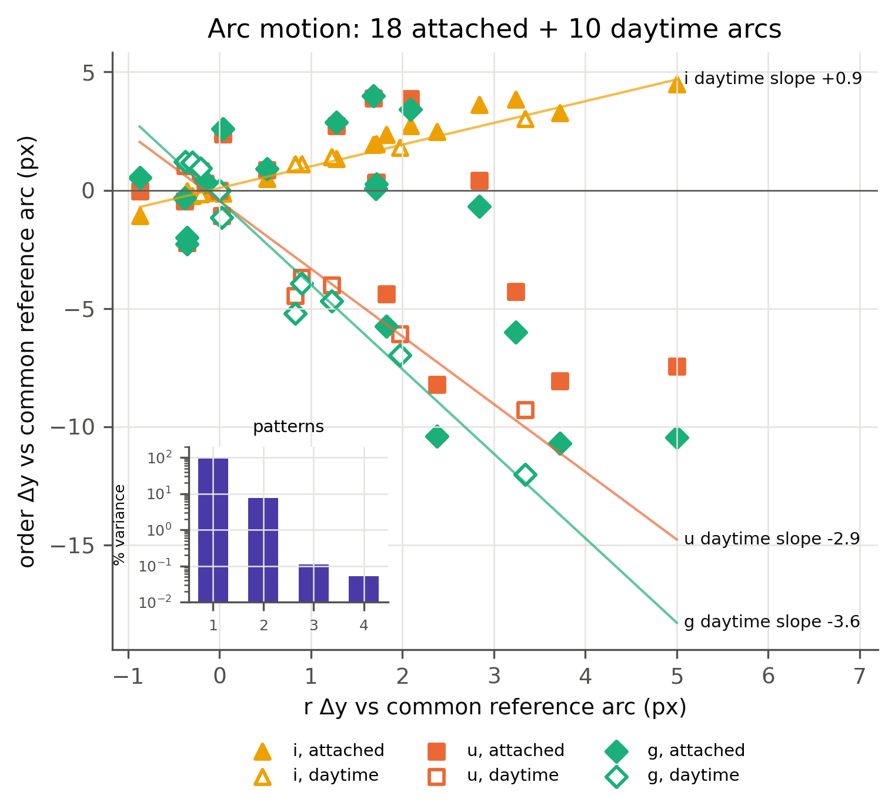
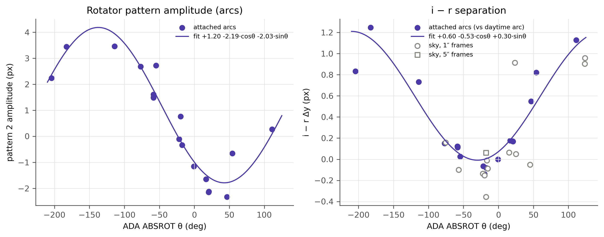

# Tightening the SOXS VIS wavelength solution

The VIS arm has four orders: r (order 1, 5380–6750 Å), u (order 2, 3480–4320 Å), g (order 3, 4320–5410 Å) and i (order 4, 6710–8500 Å).

## The problem

We calibrate each night's VIS frames with a multi-pinhole arc taken during the day. Between the science exposure and the arc, the spectra move on the detector, so a night frame's wavelength solution is slightly off.

- The arcs show motions of up to 2–3 px in r and i, and up to 4.4 px in u and g. The u/g motion has an rms of about 1.9 px, which is about 0.5 Å.
- soxspipe already tried to correct each order with night-sky emission lines, but the method had 2 compounding obstacles :
  - u and g have almost no usable sky lines. 
  - u/g run opposite to r/i on the detector, AND they move by different amounts.

## Two causes of the motion: temperature and rotator angle

We cross-correlated arcs taken at different times: 28 arcs first, then 72 arcs with a known rotator angle. Two patterns explain 99.8% of the motion (Figure 1).

1. **Thermal pattern.** It dominates the day-night difference. u and g move opposite to r and i, and 3–4 times further. It tracks the instrument temperature, but temperature alone does not predict it well. The r and i sky lines measure it directly.
2. **Rotator pattern.** Follows the derotator angle (`ESO ADA ABSROT`). It moves all four orders by similar amounts in the same direction, and a cos/sin function of the angle fits it closely (Figure 2).

The two patterns move i by nearly the same multiple of r. So the r and i sky lines alone cannot tell which pattern caused a shift, and they cannot predict u and g. The rotator angle breaks this tie. With r, i, and the angle, the u/g motion is predicted to 0.96 px (u) and 1.14 px (g), compared with 5.0 and 6.3 px with no correction.

*Figure 1. Daytime arcs move u/g opposite to r/i and 3–4× further (thermal pattern). Night arcs add a second, near-rigid pattern. Two patterns hold 99.8% of the motion.*

*Figure 2. The second pattern follows the derotator angle: a cos/sin fit captures its size in the night arcs, and the i − r separation (up to 1.2 px) follows the same angle.*

## What soxspipe now does

- **r and i.** Each order is shifted by its own median sky-line offset.
- **u and g.** soxspipe predicts the u and g shift in detector pixels from the measured r/i shift and the change in rotator angle between the science frame and the arc:

  Δy = m · (Δr + Δi)/2 + c · (cos θ_science − cos θ_arc) + s · (sin θ_science − sin θ_arc)

  The coefficients m, c and s come from the 72-arc fit and are stored in `soxs_detector_parameters.yaml`. The shift is converted to wavelength using each order's dispersion.
- **Missing angles.** Daytime arcs carry no rotator angle; the park angle of 0° is used for them. 
- **Guards.** u/g are left uncorrected, with the reason in the log, when r has fewer than 2 kept sky lines, i has fewer than 10, or the line shifts scatter by more than 1.5 px.
- **QC.** Each product records `SKY SHIFT O<N>` (nm), `SKY SHIFT O<N> PX` (detector px), and `UG SHIFT SOURCE` (`model` or `none`, with the reason).

## Results

The test set includes the 12 VIS stare frames (2026-06-26 to 2026-07-07) with a well-attached arc. Each frame was reduced twice on `develop`:

- **Unattached:** calibrated with that night's daytime arc. This is the normal case.
- **Attached:** calibrated with the well-attached night arc.

The table gives the wavelength error in Å (true position minus solution), with the median and RMS over the frames. "Before" is the arc solution alone. "After" adds the sky-line tuning and the u/g model.

| Arcs | Stage | r median | r RMS | u median | u RMS | g median | g RMS | i median | i RMS |
|---|---|---:|---:|---:|---:|---:|---:|---:|---:|
| unattached | before | +0.18 | 0.38 | +0.23 | 0.36 | +0.30 | 0.44 | +0.21 | 0.50 |
| unattached | after | +0.05 | 0.18 | −0.10 | 0.23 | −0.18 | 0.35 | +0.14 | 0.20 |
| attached | before | +0.05 | 0.09 | 0 (reference) | 0 (reference) | 0 (reference) | 0 (reference) | +0.01 | 0.03 |
| attached | after | +0.01 | 0.17 | +0.00 | 0.17 | +0.00 | 0.28 | +0.00 | 0.10 |

How each error was measured:

- **r and i:** against the sky lines, measured independently of the pipeline on the raw sky pixels with a UVES sky-atlas template. This uses 8–10 frames per cell; the others have too few lines.
- **u and g, unattached:** against the motion between the attached and the daytime arc, from cross-correlating the raw arc frames. 12 frames.
- **u and g, attached:** the frame's own arc is the reference, so the "before" error is 0 by definition. The "after" error is whatever shift the pipeline then applied. 12 frames.

The numbers are converted from px with the |dλ/dy| at each order's centre (0.37, 0.23, 0.30 and 0.45 Å/px for r, u, g and i).

What the table shows:

- **With daytime arcs, the new code helps in every order.** The RMS error falls by about half in r and i (0.38 to 0.18 Å, 0.50 to 0.20 Å), and by a third in u (0.36 to 0.23 Å). In g it falls by a fifth (0.44 to 0.35 Å). The u/g model ran on 8 of the 12 frames. On the other 4 a guard blocked it and u/g stayed unshifted.
- **An independent star check agrees.** The scatter of the Balmer line centres of the white-dwarf standards drops from 0.80 to 0.68 Å in g. In u it drops only from 0.514 to 0.505 Å, which is within the noise.
- **With a well-attached arc, the solution is already better than the tuning can make it.** Before tuning, r and i are within 0.1 Å. The sky-line shifts then add 0.1–0.3 Å of noise, mostly in r, which often has only a few usable lines. The u/g model passes that noise on to u and g. When a well-attached arc exists, the sky tuning should check the solution rather than shift it. soxspipe does not do this yet.

## Caveats

- The u/g model rests on 72 arcs from 18 nights. Refit it as more rotated arcs arrive.
- With only 2 r lines, the scatter guard is weak: two r lines that disagree by up to 3 px still pass.
- The model assumes an unbinned dispersion map.
- The r and i shifts are applied even when they rest on very few lines. In one attached frame (2026-06-26 04:43), a single r line gave a shift of −12 px (about −4.5 Å). The u/g guards blocked the model for that frame, but the r shift itself was applied.

## Further reading

All in the project's `output/` folder:

- `skyline_tuning/report.md` — review of the original sky-line method (2026-10-08).
- `arc_transfer/report.md` — attached-arc study and the two motion patterns (2026-10-09, rerun 2026-10-15).
- `rotated_mph_study/report.md` — refit on 72 rotated arcs (2026-10-16).
- `ug_transfer_dy1608/` — real-data check of the shipped code.
